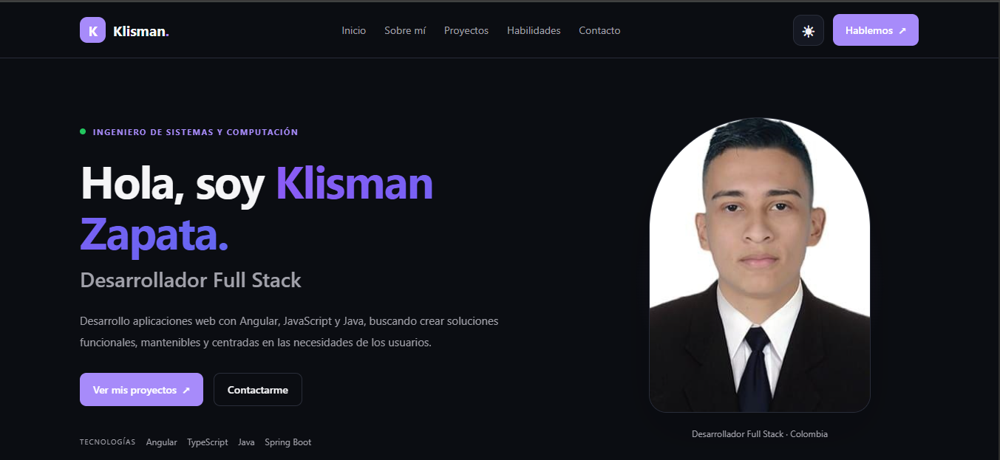
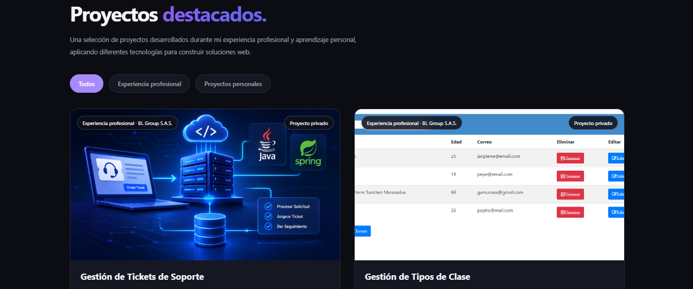
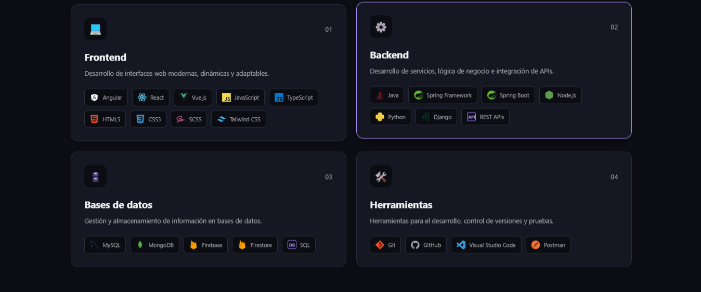
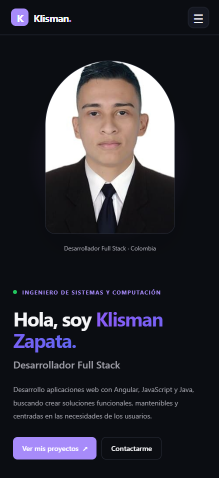

# Klisman Zapata | Portafolio

<p align="center">
  <a href="https://klismanzapata.vercel.app/">
    <strong>🌐 Ver portafolio en línea</strong>
  </a>
</p>

Portafolio personal desarrollado con **Angular, TypeScript y SCSS**, diseñado para presentar mi perfil profesional como desarrollador Full Stack, mis proyectos, habilidades técnicas y experiencia en desarrollo de software.

El proyecto cuenta con una interfaz moderna, adaptable a diferentes dispositivos y con funcionalidades interactivas que buscan ofrecer una experiencia de navegación clara y agradable.

## ✨ Características principales

- **Diseño responsive:** adaptación a dispositivos móviles, tablets y computadores.
- **Modo claro y oscuro:** cambio de tema con persistencia de la preferencia del usuario.
- **Animaciones de desplazamiento:** efectos de aparición de elementos durante la navegación.
- **Proyectos dinámicos:** visualización de proyectos y filtrado por categorías.
- **Sección de habilidades:** presentación de tecnologías y herramientas de desarrollo.
- **Formulario de contacto:** envío de mensajes mediante EmailJS.
- **Navegación intuitiva:** acceso a las diferentes secciones del portafolio.

## 🛠️ Tecnologías utilizadas

| Tecnología | Uso |
|---|---|
| Angular 21 | Framework principal |
| TypeScript | Lenguaje de programación |
| SCSS | Estilos y diseño responsive |
| HTML5 | Estructura de la aplicación |
| RxJS | Programación reactiva |
| EmailJS | Envío de mensajes desde el formulario |
| Vitest | Pruebas unitarias |
| Git y GitHub | Control de versiones |
| Vercel | Despliegue de la aplicación |

## 📂 Secciones del portafolio

- **Inicio:** presentación personal y perfil como desarrollador.
- **Sobre mí:** información profesional y trayectoria.
- **Proyectos:** muestra de proyectos personales y profesionales.
- **Habilidades:** tecnologías, lenguajes y herramientas.
- **Contacto:** formulario de contacto y enlaces profesionales.

## 🖥️ Vista previa del proyecto

### Inicio



### Proyectos



### Habilidades



### Diseño responsive



## 🚀 Instalación y ejecución local

### Requisitos previos

- Node.js y npm.
- Git.

### 1. Clonar el repositorio

```bash
git clone https://github.com/KlizmanZapata/mi-portafolio.git
```

### 2. Acceder al proyecto

```bash
cd mi-portafolio
```

### 3. Instalar dependencias

```bash
npm install
```

### 4. Ejecutar el servidor de desarrollo

```bash
npm start
```

Abre el navegador en:

```text
http://localhost:4200/
```

La aplicación se actualizará automáticamente cuando realices cambios en los archivos del proyecto.

## 📦 Compilación

Para generar la versión de producción:

```bash
npm run build
```

Los archivos compilados se generan dentro de la carpeta `dist/`.

## 📧 Configuración del formulario de contacto

El formulario utiliza EmailJS para enviar mensajes sin necesidad de implementar un backend propio.

Para configurar esta funcionalidad:

1. Crear una cuenta en [EmailJS](https://www.emailjs.com/).
2. Configurar un servicio de correo electrónico.
3. Crear una plantilla de correo.
4. Configurar los identificadores correspondientes y la clave pública en el archivo de configuración de EmailJS del proyecto.

**Importante:** no publiques claves privadas, contraseñas ni credenciales sensibles en el repositorio.

## 🌐 Despliegue

La aplicación está desplegada mediante Vercel y vinculada al repositorio de GitHub.

**Demo:** [https://klismanzapata.vercel.app/](https://klismanzapata.vercel.app/)

## 👨‍💻 Autor

**Klisman Steven Zapata González**

Ingeniero de Sistemas y Computación | Desarrollador Full Stack

- **GitHub:** [KlizmanZapata](https://github.com/KlizmanZapata)
- **LinkedIn:** [Klisman Zapata](https://www.linkedin.com/in/klizmanzapata/)
- **Portafolio:** [klismanzapata.vercel.app](https://klismanzapata.vercel.app/)
